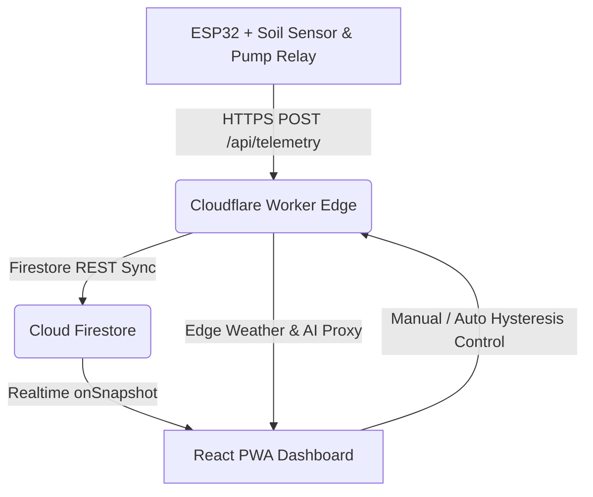

# ENZOPONIK — Smart Vertical Cocopeat Hydroponic Monitor

<div align="center">

[](https://vitejs.dev/)
[](https://react.dev/)
[](https://workers.cloudflare.com/)
[](https://firebase.google.com/)

**Harmonizing IoT automation and vertical urban agriculture through *Tri Hita Karana* (Palemahan — Harmony with Nature).**

</div>

---

## Overview

**ENZOPONIK** is a mobile-first web application and ESP32 IoT ecosystem for monitoring and automating vertical cocopeat hydroponic towers. It combines real-time capacitive soil moisture telemetry, automated pump hysteresis control, localized weather forecasting, and AI agronomy guidance across **5 languages** (`English`, `Bahasa Indonesia`, `中文 (简体)`, `Basa Jawa`, and `Basa Bali`).



## Key Features

- **Real-Time Telemetry Dashboard:** Live substrate moisture, weather temperature/humidity/UV/wind, crop health score, device uptime, and multi-range trend charts (`D` / `W` / `M` / `Custom`).
- **QR Hardware Pairing:** Camera QR scanner (`BarcodeDetector` + `jsQR` fallback) and manual pairing with 1-device-1-account ownership enforcement.
- **Vertical Cocopeat Crop Calibration:** 8 calibrated crop presets plus AI-evaluated custom crop rules with safe cocopeat hysteresis bounds (`50–80%`).
- **Agronomist AI Assistant:** Contextual dashboard diagnostics, report insights, and interactive chatbot powered by Gemini with automatic Cloudflare Workers AI fallback.
- **Multi-Language Support:** Full UI, crop guides, weather labels, alerts, and AI responses in English, Indonesian, Simplified Chinese, Javanese, and Balinese.

## Tech Stack

- **Frontend:** React 19, Vite 6, React Router 7, Recharts, Lucide Icons, jsQR
- **Backend / Edge:** Cloudflare Workers (`worker/index.js`) & Cloudflare Pages (`dist/`)
- **Database & Auth:** Firebase Authentication (Google OAuth + Email/Password) & Cloud Firestore
- **AI Engine:** Gemini REST API + Cloudflare Workers AI fallback
- **Firmware:** ESP32 DevKit V1 (`firmware/esp32_enzoponik/`)

## Getting Started

### 1. Prerequisites
- Node.js 20+ and npm
- Cloudflare Wrangler CLI (for Worker/Pages deployment)
- Arduino IDE or `arduino-cli` (for ESP32 firmware)

### 2. Environment Setup
Copy `.env.example` to `.env` and fill in your values:

```bash
cp .env.example .env
```

For ESP32 firmware, edit `firmware/esp32_enzoponik/config.h` and configure your Wi-Fi SSID, password, device ID, and Worker URL.

### 3. Local Development

```bash
npm install
npm run dev
```

### 4. Lint & Production Build

```bash
npm run lint
npm run build
```

### 5. Deploy (Cloudflare Worker + Pages)

```bash
# Set Worker secret once
npx wrangler secret put GEMINI_API_KEY

# Deploy Worker and Web App
npm run deploy:all
```

## Project Structure

```text
.
├── .github/workflows/ci.yml        # GitHub Actions CI (lint + build)
├── firmware/esp32_enzoponik/       # ESP32 firmware (sensor, pump, HTTPS telemetry)
├── public/                         # PWA manifest, icons, Cloudflare Pages _redirects
├── src/
│   ├── components/                 # AIChatbot, DeviceScannerModal, LivingNavbar, SplashScreen, ErrorBoundary
│   ├── context/                    # DataContext, UserContext, LanguageContext
│   ├── lib/                        # api, authService, cropUtils, deviceService, firebase, firebaseService, geminiUtils, agronomyService
│   ├── locales/translations.js     # 5-language translation dictionary (en, id, zh, jv, ban)
│   └── pages/                      # Dashboard, Analysis, CropConfig, Settings, Onboarding
├── worker/index.js                 # Cloudflare Worker Edge API
├── firestore.rules                 # Cloud Firestore security rules
└── wrangler.toml                   # Cloudflare Worker configuration
```
